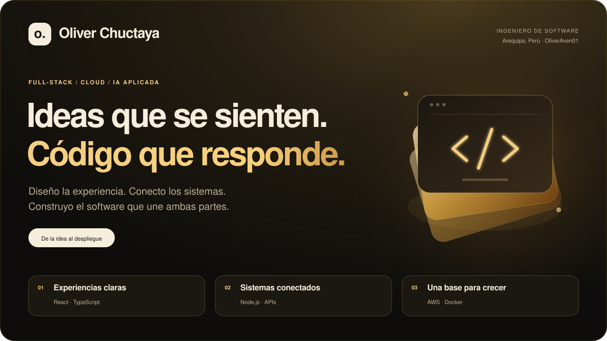
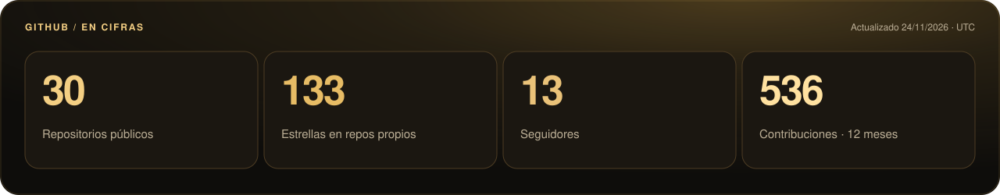
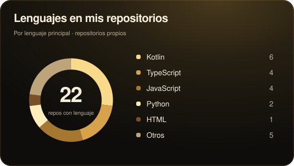
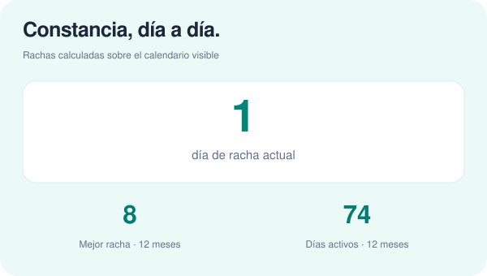
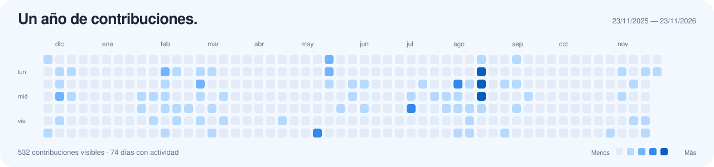
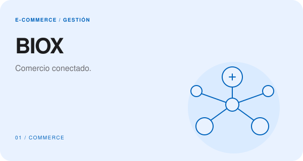
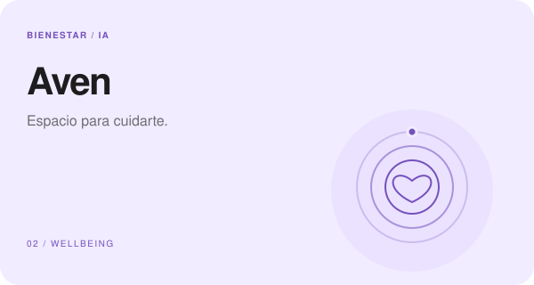
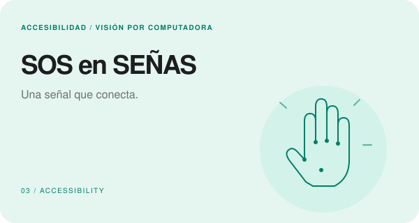
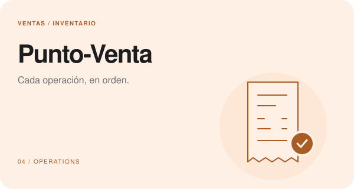
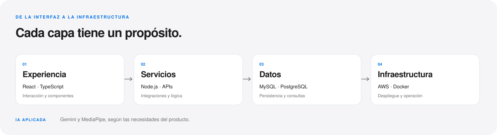

  <picture>
    <source media="(max-width: 640px)" srcset="./assets/hero-mobile.svg" />
    
  </picture>

  <a href="https://oliveraven01.biox.com.pe/">Portafolio ↗</a>
  &nbsp;&nbsp;·&nbsp;&nbsp;
  <a href="https://www.linkedin.com/in/oliverchuctaya">LinkedIn ↗</a>
  &nbsp;&nbsp;·&nbsp;&nbsp;
  <a href="mailto:oliveraven05@gmail.com">Conversemos ↗</a>

 

  <strong>Hola, soy Oliver. Construyo el producto y lo que lo hace funcionar.</strong> 
  Interfaces web, experiencias móviles, APIs y servicios en la nube. 
  Desde Arequipa, Perú, con atención a la experiencia y a la ingeniería detrás de ella.

 

  <a href="#github-en-cifras">Stats</a> &nbsp;·&nbsp;
  <a href="#sobre-mí">Sobre mí</a> &nbsp;·&nbsp;
  <a href="#proyectos-destacados">Proyectos</a> &nbsp;·&nbsp;
  <a href="#tecnologías">Tecnologías</a> &nbsp;·&nbsp;
  <a href="#experiencia">Experiencia</a> &nbsp;·&nbsp;
  <a href="#contacto">Contacto</a>

 

## GitHub en cifras

Repositorios, lenguajes y constancia. Una mirada a mi trabajo en GitHub.

  

<table>
  <tr>
    <td width="50%" align="center">
      
    </td>
    <td width="50%" align="center">
      
    </td>
  </tr>
</table>

  

Datos visibles de GitHub · Actualización diaria · Lenguajes por número de repositorios propios, sin forks.

 

## Sobre mí

Me interesa todo lo que ocurre entre una buena idea y un producto que alguien puede usar. He trabajado en proyectos freelance y entornos corporativos, desde la toma de requisitos hasta el despliegue, combinando desarrollo full-stack, arquitectura cloud-native y sistemas distribuidos.

Mi foco está en escribir código legible, construir interfaces intuitivas y diseñar soluciones que respondan a problemas reales. Trabajo principalmente con **React, TypeScript, Node.js, AWS y Docker**, e integro inteligencia artificial cuando aporta valor a la experiencia.

 

<table>
  <tr>
    <td width="33%" valign="top">
      01 / EXPERIENCIA
      <h3>Simple al usar.</h3>
      
Interfaces claras, componentes reutilizables y atención a cómo se siente cada interacción.

    </td>
    <td width="33%" valign="top">
      02 / ARQUITECTURA
      <h3>Sólido por dentro.</h3>
      
APIs, datos y servicios conectados con una estructura mantenible y preparada para evolucionar.

    </td>
    <td width="33%" valign="top">
      03 / PROPÓSITO
      <h3>Útil desde la idea.</h3>
      
Tecnología aplicada a necesidades concretas: gestión, comercio, autocuidado y accesibilidad.

    </td>
  </tr>
</table>

 

## Proyectos destacados

### La tecnología cobra sentido cuando resuelve algo.

Comercio, autocuidado, accesibilidad y operaciones. Cuatro formas de conectar una necesidad real con una solución de software.

<table>
  <tr>
    <td width="50%" valign="top">
      <picture>
        
      </picture>
        
      COMERCIO / PROYECTO PRIVADO
      <h3>Un negocio. Múltiples conexiones.</h3>
      
E-commerce que reúne un modelo multinivel, cálculo de comisiones en soles y gestión desde un panel de administración.

      
<strong>En foco:</strong> 16 rangos e integración de autenticación mediante JWT.

      
Node.js · Express · React 18 · MySQL

    </td>
    <td width="50%" valign="top">
      <picture>
        
      </picture>
        
      BIENESTAR / PROYECTO PRIVADO
      <h3>El autocuidado también se construye.</h3>
      
Aplicación que conecta inteligencia artificial, un mentor por clan y un feed social en una experiencia de autocuidado.

      
<strong>En foco:</strong> participación y progreso mediante puntos de experiencia y medallas.

      
React 19 · Capacitor · Tailwind CSS · SQLite

    </td>
  </tr>
  <tr>
    <td width="50%" valign="top">
      <picture>
        
      </picture>
        
      ACCESIBILIDAD / PROYECTO PRIVADO
      <h3>Reconocer para conectar.</h3>
      
Reconocimiento de lenguaje de señas con inteligencia artificial, integrando visión por computadora con una interfaz web.

      
<strong>En foco:</strong> interpretación de señas y activación de alertas SOS.

      
React · TypeScript · MediaPipe · Supabase

    </td>
    <td width="50%" valign="top">
      <picture>
        
      </picture>
        
      GESTIÓN / REPOSITORIO PÚBLICO
      <h3>Una visión más clara del negocio.</h3>
      
Sistema de punto de venta que conecta la gestión del inventario con el registro de ventas y la consulta de reportes.

      
<strong>En foco:</strong> reunir las operaciones habituales en una misma herramienta.

      
JavaScript · Node.js · MySQL

      
<a href="https://github.com/OliverAven01/Punto-Venta">Explorar repositorio ↗</a>

    </td>
  </tr>
</table>

 

### Más por explorar

| Proyecto | Qué hace | Tecnologías |
| :--- | :--- | :--- |
| [LectorNfcLUKA ↗](https://github.com/OliverAven01/LectorNfcLUKA) | Lectura NFC para control de acceso y registro de datos. | Python · NFC |
| [Luka-Frontend ↗](https://github.com/OliverAven01/Luka-Frontend) | Interfaz con componentes modulares e integración de APIs. | TypeScript · React |
| [movieapp01 ↗](https://github.com/OliverAven01/movieapp01) | Aplicación web de películas con APIs externas y diseño adaptable. | JavaScript · API REST |

<a href="https://github.com/OliverAven01?tab=repositories">Ver todos los repositorios ↗</a>

Las composiciones son estudios visuales del concepto de cada proyecto, no capturas de las aplicaciones. Los repositorios privados se presentan de forma descriptiva.

 

## Tecnologías

### Un stack completo. Decisiones con criterio.

Mi base de trabajo es **TypeScript, React y Node.js**, con **AWS y Docker** para la infraestructura. El resto del stack responde al contexto de cada producto.

  <picture>
    
  </picture>

<strong>Explorar el stack completo</strong>

| Área | Tecnologías |
| :--- | :--- |
| **Interfaces y móvil** | React · Next.js · Angular · TypeScript · JavaScript · HTML · CSS · Tailwind CSS · Capacitor |
| **Backend y APIs** | Node.js · Express · Python · Java · Django · Spring · Laravel · API REST |
| **Datos** | MySQL · PostgreSQL · MongoDB · SQLite · Firebase · Supabase |
| **Infraestructura** | AWS · Docker · Google Cloud · Azure · Vercel |
| **IA aplicada** | Gemini · MediaPipe |
| **Diseño y desarrollo** | Figma · Git · GitHub · GitLab · CI/CD · Linux · VS Code |

 

## Experiencia

<table>
  <tr>
    <td width="50%" valign="top">
      FREELANCE
      <h3>De la conversación al despliegue.</h3>
      
Sistemas de gestión, plataformas web, integraciones y prototipos. Participación en la definición de requisitos, implementación y entrega de soluciones adaptadas a cada proyecto.

    </td>
    <td width="50%" valign="top">
      ENTORNOS CORPORATIVOS
      <h3>Construir. Mantener. Evolucionar.</h3>
      
Aplicaciones a medida, mantenimiento de sistemas existentes y migración hacia arquitecturas modernas, con foco en código limpio y buenas prácticas.

    </td>
  </tr>
</table>

 

## Cómo trabajo

1. **Entender el problema.** Aclarar la necesidad, el contexto y lo que debe resolver el producto.
2. **Diseñar lo esencial.** Definir una experiencia clara y una arquitectura acorde con el alcance.
3. **Construir con criterio.** Desarrollar componentes, APIs e integraciones con código legible.
4. **Afinar los detalles.** Revisar el comportamiento, pulir la experiencia y preparar la entrega.

 

---

 

## Contacto

  <a href="mailto:oliveraven05@gmail.com">
    <picture>
      
    </picture>
  </a>

  Abierto a proyectos y colaboraciones. 
  Hablemos de lo que quieres construir.

  <a href="mailto:oliveraven05@gmail.com"><strong>Escríbeme ↗</strong></a>
  &nbsp;&nbsp;·&nbsp;&nbsp;
  <a href="https://wa.me/51963072856">WhatsApp ↗</a>
  &nbsp;&nbsp;·&nbsp;&nbsp;
  <a href="https://www.linkedin.com/in/oliverchuctaya">LinkedIn ↗</a>
  &nbsp;&nbsp;·&nbsp;&nbsp;
  <a href="https://oliveraven01.biox.com.pe/">Portafolio ↗</a>

 

Oliver Chuctaya Avendaño &nbsp;·&nbsp; Arequipa, Perú Diseño con intención. Código con criterio.

